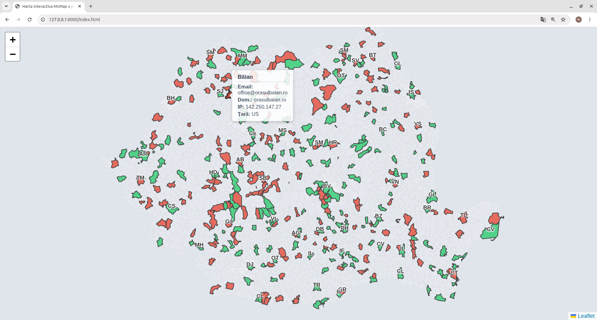

# MXMap Romania

An interactive HTML map of Romanian localities and administrative units, colored according to the email infrastructure used by the corresponding public institution.

The project was developed for an exercise about identifying where public-administration email services are hosted: in Romania, in the United States, or in another country. It follows the MXMap idea used by projects such as [MXMap Switzerland](https://mxmap.ch/) and [MXMap Netherlands](https://mxmap.nl/), but implements the data collection and visualization specifically for Romania.


## Assignment

The exercise requires:

1. Building an interactive HTML map of Romania.
2. Displaying Romanian cities, towns, municipalities, or UATs.
3. Extracting publicly available email addresses from Wikidata rather than scraping institutional websites.
4. Determining the email provider by querying DNS records, especially MX records and, where useful, SPF/TXT records.
5. Comparing the detected provider location with Romania, the United States, and other countries.
6. Hosting the resulting map on a web server.

This repository contains the data-processing script, the generated CSV data, the GeoJSON boundaries, and the browser-based map.

## Features

- Interactive Leaflet map centered on Romania.
- Locality/UAT polygons loaded from GeoJSON.
- Green polygons for mail servers whose resolved IP is reported as being in Romania.
- Red polygons for mail servers resolved outside Romania.
- Neutral styling for areas without a matching email record.
- Hover highlighting and tooltips containing:
  - locality name;
  - email address;
  - email domain;
  - resolved mail-server IP;
  - detected country code.
- County abbreviations displayed on the map.

## Project structure

| File | Purpose |
| --- | --- |
| `index.html` | HTML entry point and third-party browser libraries. |
| `app.js` | Initializes Leaflet, loads the CSV and GeoJSON, matches records, colors polygons, and creates tooltips. |
| `styles.css` | Map layout, county-label, and tooltip styling. |
| `uat_email_2.py` | Data-processing script: reads Wikidata-exported email addresses, performs DNS lookups, resolves mail-server IPs, and writes the result CSV. |
| `wikidata_query_service.txt` | SPARQL query used to obtain Romanian localities and their Wikidata email statements. |
| `rezultate_mxmap.csv` | Processed data consumed by the web map. |
| `romania-uat.geojson` | Geographic boundaries used to draw the map. |
| `UAT2.csv` | Input CSV expected by the Python script; it should be obtained from the Wikidata query/export step and is not included in this repository. |

## Data pipeline

### 1. Extracting data from Wikidata

The project uses Wikidata's SPARQL service and does not scrape municipality websites. The query in `wikidata_query_service.txt` selects Romanian entities classified as municipalities or cities/towns and optionally retrieves the email property `P968`.

The query can be run in the [Wikidata Query Service](https://query.wikidata.org/). Export the results as CSV and provide that file as `UAT2.csv` in the project directory.

The query currently uses these Wikidata classes:

- `Q640364` — municipality;
- `Q16858213` — city or town in Romania.

The query can be extended to cover additional UAT classes if a more granular administrative dataset is required.

### 2. DNS and provider detection

The script in `uat_email_2.py` uses [Scapy](https://scapy.net/) to send DNS packets directly to Google's public DNS resolver (`8.8.8.8`):

1. Extract the domain after `@` from each available email address.
2. Send an MX query (`QTYPE=MX`) for that domain.
3. Read the mail-exchange hostname from the MX answer.
4. Send an A query (`QTYPE=A`) for the mail-exchange hostname.
5. Extract the resulting IPv4 address.
6. Query the `ip-api.com` JSON endpoint for the IP's country code.
7. Write the domain, mail-server IP, and country code into `rezultate_mxmap.csv`.

For example, an address such as `primaria@primariamarasesti.ro` produces the domain `primariamarasesti.ro`. An MX response may point to `mail.primariamarasesti.ro`, which is then resolved to an IP address and geographically classified.

The current implementation uses MX and A records. SPF/TXT queries are relevant to the assignment and can be added as a second signal when a domain publishes infrastructure in its SPF record. An SPF record should not be treated as a definitive replacement for MX data, because SPF describes authorized senders and may include third-party services that are not the mailbox provider.

### 3. Rendering the map

`app.js` loads:

- `rezultate_mxmap.csv` with [Papa Parse](https://www.papaparse.com/);
- `romania-uat.geojson` with the browser `fetch()` API;
- [Leaflet](https://leafletjs.com/) for the interactive map;
- [Turf.js](https://turfjs.org/) to calculate county-label positions.

Each GeoJSON feature is matched to a CSV row by normalized locality name. A matching row with `tara_server=RO` is colored green; a matching row with another country code is colored red. Features without a matching record remain neutral.

## Requirements

### Runtime requirements

- Python 3.9 or newer.
- A web browser with JavaScript enabled.
- An HTTP server for the map. Opening `index.html` directly with a `file://` URL is not recommended because browser security rules can block CSV and GeoJSON requests.

### Python dependencies

Install the dependencies used by `uat_email_2.py`:

```bash
python3 -m pip install requests scapy
```

Depending on the operating system, Scapy may require permission to create and send raw network packets. Run the script with the appropriate privileges for your environment if DNS requests fail.

## Rebuilding the processed CSV

1. Export the Wikidata query results as CSV.
2. Save the export as `UAT2.csv` in the project directory.
3. Run:

   ```bash
   python3 uat_email_2.py
   ```

The script creates or replaces `rezultate_mxmap.csv`.

The script intentionally waits 1.5 seconds between records to reduce the request rate to the IP geolocation service. It also uses timeouts for DNS and HTTP requests. Records without an email address are retained with `N/A` values.

## Running the map locally

From the project directory, start Python's built-in HTTP server:

```bash
python3 -m http.server 8000 --bind 127.0.0.1
```

Open [http://127.0.0.1:8000/](http://127.0.0.1:8000/) in a browser.

The server must be started from the directory containing `index.html`, `app.js`, `styles.css`, `rezultate_mxmap.csv`, and `romania-uat.geojson`.

## Hosting

The project can be hosted by any static web server that serves the files over HTTP or HTTPS. For example:

```bash
python3 -m http.server 8000 --bind 0.0.0.0
```

For public hosting, use a production web server such as Nginx or Apache, configure the document root to this directory, and serve the application over HTTPS. The server must make both data files available at the paths expected by `app.js`.

The GeoJSON file is approximately 127 MB. Standard GitHub repositories reject files larger than 100 MB, so the GeoJSON should be stored with Git LFS or hosted through another data/static-file service when deploying through GitHub.

## Interpretation and limitations

- A green area means that the resolved mail-server IP was reported as `RO` by the geolocation service; it does not prove that the entire email provider or all stored data is physically located in Romania.
- A red area means that the resolved IP was reported outside Romania; it does not by itself identify the provider company or prove the legal location of stored messages.
- DNS configurations can use multiple MX records, aliases, CDNs, cloud platforms, or shared infrastructure.
- The current script examines the first matching MX record and resolves an A record. Production analysis should inspect all MX records, follow CNAMEs, consider IPv6 (`AAAA`), and preserve DNS priorities.
- IP geolocation databases can be incomplete or inaccurate.
- `ip-api.com` is an external service and its availability, rate limits, and terms should be considered before large-scale reruns.
- Wikidata records may be missing, outdated, duplicated, or contain addresses that are not mailbox addresses.
- The map currently matches features and CSV rows by locality name. Name variants, diacritics, and duplicate names can cause unmatched or ambiguous records.
- The map uses third-party JavaScript libraries from CDNs, so production hosting requires network access to those CDNs or locally vendored copies.

## Possible extensions

- Query TXT records and parse SPF mechanisms in addition to MX records.
- Inspect every MX record and every resolved IPv4/IPv6 address.
- Map provider organizations using ASN or WHOIS data, not only country codes.
- Add a legend and filters for Romania, the United States, and other countries.
- Use stable Wikidata Q-IDs to join records instead of locality names.
- Add caching and retry handling for DNS and geolocation requests.
- Use a smaller or simplified GeoJSON file to improve browser load time.

## References

- [Wikidata Query Service](https://query.wikidata.org/)
- [Wikidata email property P968](https://www.wikidata.org/wiki/Property:P968)
- [DNS MX records](https://www.cloudflare.com/learning/dns/dns-records/dns-mx-record/)
- [SPF / Sender Policy Framework](https://www.mimecast.com/content/sender-policy-framework/)
- [Scapy](https://scapy.net/)
- [Leaflet](https://leafletjs.com/)
- [Papa Parse](https://www.papaparse.com/)
- [Turf.js](https://turfjs.org/)
- [MXMap Switzerland](https://mxmap.ch/)
- [MXMap Netherlands](https://mxmap.nl/)
